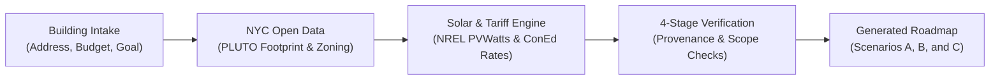

# Professor Fritts — Building Renewable Energy Planner

https://github.com/user-attachments/assets/aade091b-ec65-4933-92f2-294a5a35e965

*Video walkthrough: landing, building intake for P.S. 236 (Bronx elementary school), live AI analysis, multi-scenario clean energy roadmap, and interactive follow-up guidance.*

> [!NOTE]
> **Live Deployment & Demo Mode Notice:**  
> The live deployment is hosted in **Demo Mode** with pre-configured NYC case studies and simulated tool responses to conserve live LLM API keys and cloud rate limits.  
> 
> **To see the full, live AI agent workflow from raw input to generated roadmap, please watch the video walkthrough above.** You can also explore the interactive demo deployment or run the project locally with live Anthropic API keys.

---

## Live Deployments

- **Frontend (Vercel):** [https://professor-fritts-clean-energy.vercel.app](https://professor-fritts-clean-energy.vercel.app)  
  *Built with Next.js 16, TypeScript, Tailwind CSS, and shadcn/ui.*
- **Backend API (Render):** [https://professor-fritts-brain-powered.onrender.com](https://professor-fritts-brain-powered.onrender.com)  
  *Dual-layer FastAPI + Django architecture running via Uvicorn.*

---

## At a Glance

| Pillar | How It Works |
| :--- | :--- |
| **Target Audience** | NYC municipal building managers (schools, public libraries, recreation centers, and civic buildings) navigating clean energy goals and NYC Local Law 97 carbon limits. |
| **Core Function** | Ingests a building profile and capital budget, queries public municipal & solar datasets, and generates an automated 3-scenario clean energy roadmap in seconds. |
| **Trust & Guardrails** | **Zero hallucinations.** Every number is labeled (`FACT`, `ESTIMATE`, `ASSUMPTION`, `RECOMMENDATION`) with cited data sources, formulas, and required professional engineering referrals. |
| **Tech Stack** | Next.js 16, TypeScript, Tailwind CSS, Python 3.12, FastAPI, Django, Anthropic Claude (with function calling & prompt caching), and Supabase PostgreSQL. |

---

## The Problem & The Solution

### The Challenge
New York City has set aggressive building decarbonization mandates (such as Local Law 97), requiring public and commercial buildings to drastically curb carbon emissions or face substantial fines. However:
- **Preliminary feasibility studies are slow and expensive:** Facility directors often wait 3–6 months and spend tens of thousands of dollars on preliminary engineering audits just to see what might be viable.
- **Generic AI cannot be trusted with capital planning:** Standard LLMs hallucinate energy savings, misquote electric utility tariffs, and cannot reliably verify rooftop physical limits or NYC building codes.

### How Professor Fritts Solves It
Professor Fritts acts as an intelligent, transparent pre-engineering advisor. By pairing an advanced AI reasoning engine with deterministic computational tools and official municipal records, it delivers:
1. **Instant, realistic feasibility modeling** based on the building's verified NYC tax lot footprint.
2. **Three side-by-side scenarios** comparing costs, annual energy offsets, carbon reductions, and payback periods.
3. **Plain-English executive summaries** with instant clarity on budget and goal feasibility.
4. **Transparent audit trails**, ensuring facility managers know exactly which numbers are hard facts, which are estimates, and which professional reviews are mandatory before spending public funds.

---

## What a Plan Delivers

Every roadmap provides a structured breakdown designed for both executive decision-makers and technical facilities engineers:

### 1. Plain-Words Executive Summary & Decision Pill
At the top of every generated plan, the agent provides an immediate, plain-language assessment of feasibility:
- **Status Pills:** E.g., `Goal reached within budget`, `Reachable, may run over budget`, or `Needs a roofer first`.
- **In Plain Words:** A 2–3 sentence executive synopsis outlining whether the target is met, existing system constraints, and recommended next steps.

### 2. Three Side-by-Side Scenarios
Rather than pushing a single black-box answer, the agent generates three distinct pathways:
- **Scenario A (Solar PV Only):** Sizes rooftop solar based on usable unshaded area. Maximizes return on investment with the fastest payback period.
- **Scenario B (Solar + Battery Storage):** Adds battery energy storage sized for critical emergency backup loads (e.g., cooling centers, essential lighting, refrigeration during grid outages).
- **Scenario C (Solar + Storage + Efficiency):** Combines rooftop solar and storage with deep building envelope & LED efficiency upgrades for maximum long-term carbon reduction.



---

## Engineering Deep Dive & Anti-Hallucination Architecture

Professor Fritts is built with a defense-in-depth architecture to ensure reliable, verifiable agentic outputs.

### 1. The 4-Stage Verification Pipeline
The agent operates through a deterministic 4-stage validation loop (`backend/agent/checks.py`):
1. **Check 1 (Scope):** Validates NYC jurisdiction (all five boroughs). Enforces mandatory inputs (budget and energy reduction targets); halts out-of-scope requests before any LLM calls are made.
2. **Check 2 (Tool Control & Limits):** Restricts tool execution to registered calculation and lookup functions with strict timeout ceilings and retry limits.
3. **Check 3 (Provenance & Prompt Injection Filter):** Quarantines external web snippets containing hidden prompt injection instructions ("ignore previous instructions..."). Untrusted external text is excluded from LLM reasoning.
4. **Check 4 (Evidence & Mandatory Disclosures):**
   - **Labeling Enforcement:** Rejects any output containing ungrounded claims. Every figure must have a tag (`FACT`, `ESTIMATE`, `ASSUMPTION`, `RECOMMENDATION`) and an accompanying `source_url` or formula `calc_id`.
   - **Mandatory Referrals:** Mandates licensed professional referrals (PE structural review for rooftop load, licensed electrician for service connection, FEMA flood zone elevations, and LPC landmark reviews where applicable).
   - **No False Guarantees:** Rejects any wording promising guaranteed energy or financial savings.

### 2. Data Integrations & Tools
- **NYC Open Data / PLUTO Footprints:** Resolves tax lot outlines to estimate usable flat rooftop area and checks historical landmark/parkland designations.
- **NREL PVWatts v8:** Simulates hourly solar radiance, system losses, and annual kWh generation for NYC latitude/longitude.
- **EIA & Con Edison Tariffs:** Applies commercial electricity rates and demand charges.
- **FEMA Flood Data:** Identifies flood hazard zones (AE, VE) to flag required equipment elevation above the Design Flood Elevation.

---

## System Architecture & Tech Stack

```
professor-fritts-clean-energy/
├── frontend/                  # Next.js 16 App Router web application
│   ├── app/                   # App routes (landing, plan report, replay)
│   ├── components/            # UI components (shadcn/ui, FrittsGuide, charts)
│   └── lib/                   # API clients and TypeScript interfaces
├── backend/                   # Python 3.12 backend (FastAPI + Django)
│   ├── agent/                 # Agent harness, prompts, checks, and evals
│   ├── api/                   # FastAPI async routers (plans, records, replay)
│   ├── fritts/                # Django project settings, ASGI, and database models
│   └── tools/                 # Tool implementations (footprints, PVWatts, rates, injection)
└── documentation/             # Product specs, PRDs, and real NYC case studies
```

- **Frontend:** Next.js 16, TypeScript, Tailwind CSS, shadcn/ui. Deployed on **Vercel**.
- **Backend:** Dual-layer architecture combining **FastAPI** (high-throughput async endpoints) with **Django** (ORM, migrations, database admin). Deployed on **Render**.
- **AI Agent Engine:** Anthropic Claude (via Claude API) utilizing structured function calling and prompt caching to reduce token latency and cost.
- **Database:** Supabase PostgreSQL with session connection pooling.

---

## Local Setup

### Prerequisites
- Node.js 18+ and npm
- Python 3.12+
- Anthropic API key (optional for mocked/scripted mode, required for live Claude runs)

### Quickstart

1. **Clone the repository and set environment variables:**
   ```bash
   git clone https://github.com/justin-day-pursuit/professor-fritts-clean-energy.git
   cd professor-fritts-clean-energy
   cp .env.example .env
   # Add your ANTHROPIC_API_KEY in .env if testing live AI runs
   ```

2. **Frontend setup:**
   ```bash
   cd frontend
   npm install
   npm run dev
   # Runs on http://localhost:3000
   ```

3. **Backend setup:**
   ```bash
   cd ../backend
   python3.12 -m venv .venv
   source .venv/bin/activate
   pip install -r requirements.txt
   python manage.py migrate
   
   # Start the API server in scripted/mock mode (requires no API key)
   LLM_PROVIDER=scripted TOOL_MODE=mock uvicorn fritts.asgi:app --reload --port 8000
   ```

---

## About the Name

**Charles Fritts (1850–1903)** was an American inventor who created one of the world's very first working solar cells in 1883 using selenium coated with an ultra-thin layer of gold. In 1884, Fritts installed what is recognized as the world's first rooftop solar array right here in New York City.

Professor Fritts honors that legacy by guiding the next century of New York City buildings toward sustainable, resilient, and accessible clean energy.

---

## Authors & Credits

Developed with pride by:

- **Justin Day** — [`justin.day@pursuit.org`](mailto:justin.day@pursuit.org) · [GitHub (@justin-day-pursuit)](https://github.com/justin-day-pursuit)
- **Mara Munoz** — [`mara.munoz@pursuit.org`](mailto:mara.munoz@pursuit.org) · [GitHub (@mara-munoz)](https://github.com/mara-munoz)
